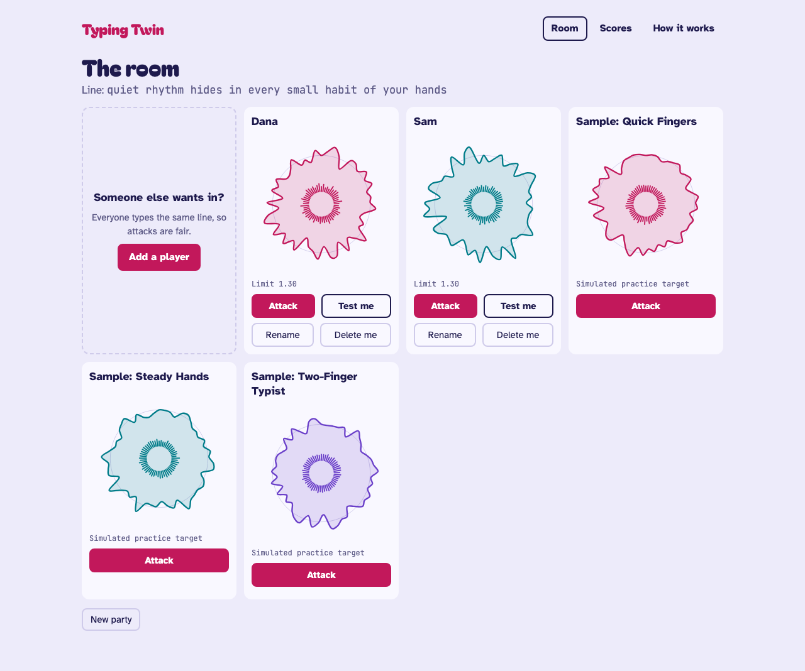

# Typing Twin

A party game that draws your typing rhythm as a signature, then dares your friends to pass as you.

**Play it: [typingtwin.com](https://typingtwin.com)**



## Play it

1. Open the site on a computer and start a party. There's no sign-up.
2. Type one sentence 5 times. The first is a warm-up.
3. See your rhythm drawn as a ring, and hear it played back.
4. Enter the room. Add friends on the same keyboard, or attack one of the three simulated typists.
5. Try to type the line the way someone else does. The game says whether you passed as them, how close you came, and gives a one-line clue about what was off.

You can also test your own signature, try to disguise it, and watch a replay attack beat a target with their own typical timing.

The game needs a physical keyboard. On a phone you can look around and watch a replay, but not type. See the [roadmap](#roadmap).

## How it works

The browser records when each key goes down and up. From that, the server measures two things:

- **Hold:** how long each key stays down.
- **Flight:** the time from one key going down to the next.

Your training lines become a profile: an average and a spread for each timing. A new line is scored by how far each of its timings sits from that average, measured in that timing's own spread. The average of those is the distance, and a distance under the player's limit passes as them. The method is called scaled Manhattan distance.

The full method, with numbers and how to reproduce them, is in [`evaluation/results.md`](evaluation/results.md).

## Results and limits

The scoring method was tested on the CMU Keystroke Dynamics Benchmark (Killourhy and Maxion, 2009). It reached a mean equal error rate of **9.1%**, close to the roughly 10% the paper reports for the same method.

That number is not the game's accuracy:

- The benchmark has 51 people typing one fixed password 400 times each. The game builds a profile from 3 or 4 lines of a sentence.
- The game uses its own provisional settings, tuned for a few training lines. Nobody has measured its accuracy.
- Signatures can look alike, and a distinctive shape doesn't prove anyone is unique.
- A replay of someone's typical timing passes as them. Rhythm can't be the only check on anything that matters.

This is a game and a demo, not a security product.

## Architecture

```
Browser                         One FastAPI process                  Optional
TypeScript, built with Vite     DigitalOcean App Platform            Postgres

key down/up timing  ──HTTPS──▶  api/    routes, origin check,
                                        rate limits
rings, rooms, scores ◀────────  game/   parties and profiles,  ───▶  score_attempts
                                        in memory                    opted-in scores only,
                                core/   pure scoring logic           written in the background
```

- **All scoring runs on the server**, in `src/keystroke_dynamics/core/`. That code is pure Python with no web or database imports, so it's tested alone.
- **Game state lives in memory.** A party disappears when it's deleted, after 2 hours idle, or when the app restarts. The game needs no database.
- **One worker process**, because that memory isn't shared.
- **Scores are optional.** If the scores database is missing or down, the game plays on.
- **No third-party requests.** Fonts are self-hosted, and a content security policy blocks inline scripts.

Every push to `master` deploys. [`DEPLOY.md`](DEPLOY.md) has the setup.

The repository also holds an older account-based demo, where typing is a second signal next to a password. It's switched off on the live site. See [`docs/account-demo.md`](docs/account-demo.md).

## Run it locally

With [Docker Compose](https://docs.docker.com/compose/):

```bash
docker compose up --build
```

Then open <http://127.0.0.1:8000>, not `localhost`, which the origin check rejects. There's no database and nothing else to install.

Without Docker, you need Python 3.12 or newer with [`uv`](https://docs.astral.sh/uv/), and Node.js 22 or newer:

```bash
uv sync
cd frontend && npm install && npm run build && cd ..
DEBUG=true uv run uvicorn keystroke_dynamics.main:app --reload
```

### Run the tests

The backend tests need a disposable Postgres, because they also cover the account demo and score collection:

```bash
docker compose -f docker-compose.test.yml up -d
uv sync --group evaluation
uv run pytest
uv run ruff check . && uv run ruff format --check .
uv run mypy src
```

Frontend:

```bash
cd frontend
npm run typecheck && npm run test && npm run build
npm run e2e    # Playwright, against a running app. See frontend/README.md
```

## Privacy and security

**Sent to the server:** which key, whether it went down or up, and when, for the game's line only. The line is fixed, so the game never sees anything you'd type elsewhere.

**Kept in memory:** each player's name and timing statistics, and the party's attempts. They go when you choose **Delete me** or **New party**, after 2 hours idle, or when the app restarts. Everyone in a party can see its names and signatures.

**Never stored or logged:** raw keystrokes and their timings. They're discarded after each request.

**Opt-in score sharing:** a player can tick "Share my scores to help test this". It's off by default and never needed to play. An opted-in result stores:

- the date, the line, the kind of attempt and target, the device type, and whether it passed
- pace, distance, and the limit
- random IDs that group a party's attempts
- the scoring and consent wording versions, and how much data the score used

It never stores names, keystrokes, timings, or IP addresses. **Delete me** and **New party** remove a player's rows, and rows are deleted after 12 months by default.

**Security:**

- The session cookie is signed, `HttpOnly`, `SameSite=Lax`, and `Secure`.
- Every state-changing request is checked against the `Origin` header.
- Request size and event counts are capped.
- Requests are rate-limited by IP address, which is never stored with scores.

## History

- **2012:** my thesis on access control by keyboard rhythm. Its method is reconstructed in [`evaluation/results.md`](evaluation/results.md) for comparison.
- **2016 to 2018:** a personal web app in Python 2 and Flask, built on the same idea.
- **2026:** rewritten from scratch in Python 3, then turned into this game. The plans and what came of them are in [`docs/plans/`](docs/plans/README.md).

## Roadmap

- **Shareable rooms:** start a room, share its link, and play live from separate computers. See [`docs/plans/active/ROOMS_PLAN.md`](docs/plans/active/ROOMS_PLAN.md).
- **Mobile:** the full game on a phone, with an on-page keyboard that also scores where your thumbs land. See [`docs/plans/active/MOBILE_PLAN.md`](docs/plans/active/MOBILE_PLAN.md).

Smaller open items are in [`TODO.md`](TODO.md).
